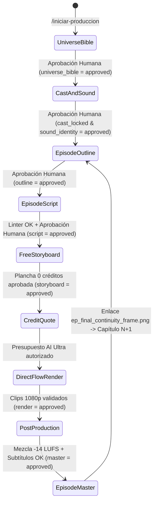

# Especificación Arquitectónica — FlowForge Studio

## 1. Principios de Diseño (Clean & Screaming Architecture)

El árbol de directorios expresa de inmediato su propósito cinematográfico (Screaming Architecture), desacoplando por completo **el motor reusable** (`.agents/plugins/flowforge-studio/`, `templates/`, `bin/`) de **los cartuchos de estado narrativo** (`productions/{production_slug}/`).

```text
~/flowforge-studio/
├── AGENTS.md                                      # Constitución global del estudio
├── README.md                                      # Guía ejecutiva de uso
├── ARCHITECTURE.md                                # Diseño técnico y máquina de estados
├── bin/
│   ├── doctor.sh                                  # Verificación silenciosa de dependencias
│   └── open-flow-session.sh                       # Apertura de perfil aislado de Chrome para Flow
├── templates/
│   ├── cast_registry.schema.json                  # Esquema JSON de bóveda de reparto
│   └── shot_manifest.schema.json                  # Esquema JSON de manifiesto de planos
├── productions/                                   # Cartuchos herméticos por serie / corto / videoclip
│   └── {production_slug}/
│       ├── production.yaml                        # Estado maestro, visual_dna y topes de créditos
│       ├── credit_ledger.json                     # Libro mayor auditable de créditos AI Ultra
│       ├── 01_universe_bible/                     # Biblia de mundo y arco de temporada
│       ├── 02_cast_and_ingredients/               # cast_registry.json + retratos 0 créditos
│       ├── 03_sound_and_music/                    # sound_bible.md + voice_cast.json + pistas
│       └── episodes/
│           └── ep_01_{slug}/
│               ├── episode.yaml                   # Compuertas HITL del capítulo
│               ├── 01_script/                     # literary_script.md + shot_manifest.json
│               ├── 02_storyboard/                 # keyframes/ + storyboard_grid.png (0 créditos)
│               ├── 03_flow_renders/               # raw_clips/ + continuity_frames/
│               ├── 04_dialogue_and_sfx/           # Locuciones y transcripciones verificadas
│               └── 05_master/                     # MP4 final (-14 LUFS) + ep_final_continuity_frame.png
└── .agents/
    └── plugins/
        └── flowforge-studio/
            ├── plugin.json                        # Manifiesto oficial Antigravity 2.0
            ├── mcp_config.json                    # Servidor MCP local flowforge-engine
            ├── assets/logo.svg
            ├── rules/AGENTS.md
            ├── agents/                            # 7 agentes/subagentes especializados
            ├── skills/                            # 8 skills progresivos
            └── scripts/flowforge_mcp_server.py    # Servidor MCP Stdio JSON-RPC 2.0
```

---

## 2. Máquina de Estados y Compuertas Humanas (`HITL`)



---

## 3. Contratos de Integración entre `flowforge-engine` y `google-flow`

1. **Validación Estática antes de Automatización Web:** Ninguna instrucción llega al navegador (`google-flow`) sin pasar por `flowforge_validate_shot_manifest`. Esto evita perder créditos por duraciones ilegales (p. ej. pedir `12s` a `Veo 3.1`, que es fijo de `8s`) o por multiplicadores `x2` olvidados en la interfaz.
2. **Compilación Determinista de Prompts (`compiled_flow_prompt`):** `flowforge_validate_shot_manifest` concatena automáticamente los descriptores literales de `cast_registry.json` + el `motion_prompt` + el `visual_dna` de `production.yaml`, resolviendo de raíz la falta de memoria entre escenas de Google Flow.
3. **Tolerancia a Latencia sin Doble Gasto:** Toda llamada a `google-flow` respeta tickets asíncronos (`still_working` -> `flow_wait`) y registra cada transacción real en `credit_ledger.json`.
