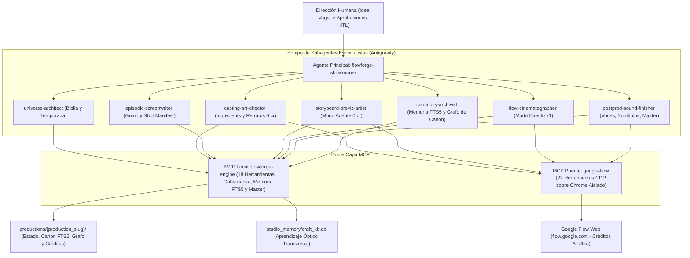

# FlowForge Studio (`~/flowforge-studio`)

Framework integral de dirección y producción audiovisual para **Google Antigravity + Google Flow (`flow.google.com`)**, diseñado para llevar cualquier obra desde **una idea vaga de una línea** hasta **capítulos completos masterizados (`1080p`, `-14 LUFS`)** maximizando la eficiencia de la suscripción **Google AI Ultra**.

---

## Arquitectura General del Framework



---

## Qué Problemas Reales Resuelve

1. **Google Flow no tiene memoria entre escenas ni entre proyectos:** `FlowForge Studio` mantiene una bóveda local (`cast_registry.json`) con una **ficha estructurada** por personaje, criatura, objeto y escenario (rasgos obligatorios por tipo + rasgos invariables). De cada ficha se compila un núcleo en inglés (`verbatim_prompt_descriptor`, máx. 90 palabras) que se inyecta automáticamente en cada plano junto con el escenario, los objetos y quién los sostiene, y el retrato se adjunta como referencia visual.
2. **Separación inteligente entre Modo Agente y Modo Directo:**
   - **Modo Agente ACTIVADO (`flow_agent_images`, 0 créditos):** Usado exclusivamente en preproducción para levantar *storyboards* en paralelo sin gastar saldo.
   - **Modo Directo / Agente DESACTIVADO (`flow_generate`, lote `x1`):** Usado en el rodaje principal de video para conservar control óptico literal, cotización previa de créditos y botón *Retry* gratuito.
3. **Linter Pre-Vuelo Anti-Desperdicio de Créditos (`flowforge_validate_shot_manifest`):** Bloquea multiplicadores accidentales (`x2`/`x4`), duraciones incompatibles por modelo, frases negativas que alucinan objetos y diálogos sin marcas de tiempo en segundos.
4. **Continuidad Multicapítulo Frame-a-Frame:** Al masterizar el Capítulo `N`, el motor extrae automáticamente `ep_final_continuity_frame.png` y lo enlaza como punto de partida del Capítulo `N+1`.
5. **Memoria Persistente, Indexación Híbrida FTS5 (BM25) y Grafo de Canon:** Indexa incrementalmente por SHA-256 biblias, guiones, planos, subtítulos `.srt` y documentos de `00_references/` en SQLite FTS5 (`unicode61` sin tildes), versiona memorias y grafo de entidades en `memory/canon_snapshot.json` y separa una base global `.studio_memory/craft_kb.db` para aprendizajes técnicos de cámara y sonido reutilizables entre series.

---

## Componentes Incluidos

### 1. Agentes y Subagentes (`.agents/plugins/flowforge-studio/agents/`)
| Agente | Rol en el Estudio |
| :--- | :--- |
| `flowforge-showrunner` | Productor ejecutivo principal (`mainAgent: true`). Orquesta fases, compuertas humanas y presupuesto. |
| `universe-architect` | Convierte semillas vagas en `universe_bible.md`, `visual_dna` y arco multicapítulo `season_01_arc.md`. |
| `casting-art-director` | Construye `cast_registry.json` y retratos maestros ilustrados a **0 créditos** (evitando bloqueos por fotos reales). |
| `episodic-screenwriter` | Redacta guion literario y desglose técnico `shot_manifest.json` adaptado a la física de Veo y Omni Flash. |
| `storyboard-previz-artist` | Genera viñetas y *First/Last Frames* a **0 créditos** y arma la plancha `storyboard_grid.png`. |
| `flow-cinematographer` | Rueda video en Modo Directo (`x1`), controla tickets asíncronos (`flow_wait`) y descarga `1080p` gratis. |
| `postprod-sound-finisher` | Graba voces (`flow_narrate`), verifica transcripción (`flow_transcribe` -> `flow_captions`) y masteriza a `-14 LUFS`. |
| `continuity-archivist` | Mantiene el índice FTS5, memorias evolutivas (`topic_key`), grafo de relaciones y dossiers 360° por episodio. |

### 2. Skills Operativos (`.agents/plugins/flowforge-studio/skills/`)
- `/iniciar-produccion`: De idea vaga a cartucho inicializado, biblia de universo y arco de temporada.
- `/disenar-universo-y-reparto`: Fijación de reparto, utilería, escenarios y mapa vocal a 0 créditos.
- `/escribir-capitulo`: Escaleta, guion literario y validación completa de `shot_manifest.json`.
- `/crear-storyboard-gratis`: Storyboard y *First/Last Frames* gratuitos + plancha visual de contacto.
- `/rodar-capitulo-flow`: Cotización AI Ultra, rodaje seguro en Modo Directo y raccord exacto.
- `/postproducir-capitulo`: Locución, mezcla musical con *ducking*, subtítulos verificados y máster MP4.
- `/indexar-canon` (`memoria-e-indexacion`): Indexación documental FTS5, memoria de canon, grafo de entidades y base de oficio óptico.
- `flow-prompt-engineering`: Diccionario óptico, costos por modelo y 7 leyes físicas anti-morphing.
- `continuidad-multicapitulo`: Enlace visual y rehidratación de reparto del Capítulo `N` al `N+1`.

### 3. Servidores MCP Integrados
- **`flowforge-engine` (incluido en este framework, 18 herramientas):**
  - *Gobernanza y Multimedia (11):* `flowforge_init_production`, `flowforge_init_episode`, `flowforge_check_gates`, `flowforge_set_gate`, `flowforge_register_cast_asset`, `flowforge_validate_shot_manifest`, `flowforge_quote_and_log_credits`, `flowforge_extract_frame`, `flowforge_probe_media`, `flowforge_render_contact_sheet`, `flowforge_master_episode`.
  - *Memoria, Indexación FTS5 y Grafo (7):* `flowforge_index_production`, `flowforge_search`, `flowforge_memory_save`, `flowforge_memory_context`, `flowforge_graph_link`, `flowforge_entity_dossier`, `flowforge_craft_kb`.
- **`google-flow` (configurado globalmente en Antigravity):** 22 herramientas sobre Chrome aislado (`~/.flow-mcp/chrome-profile`) para operar `flow.google.com` con los créditos de Google AI Ultra.

---

## Guía de Uso

### Inicio Rápido

1. Instalar y verificar el entorno **una sola vez** (sección 1).
2. Abrir la carpeta `/home/gabrielcruzsoto/flowforge-studio` como Workspace en **Google Antigravity**.
3. Escribir en el chat:
   > `/iniciar-produccion Quiero hacer una serie sobre [tu idea vaga en una línea]`
4. Responder y aprobar cada fase cuando el `flowforge-showrunner` se detenga a pedirlo (sección 3).

---

### 1. Instalación y Verificación (una sola vez)

> [!NOTE]
> Estos son los **únicos** pasos de terminal del framework. Una vez completados, toda la producción se dirige desde el chat de Antigravity (Ley 00 de `AGENTS.md`).

**Requisitos:**

| Componente | Uso | Verificación |
| :--- | :--- | :--- |
| Python 3 + PyYAML (`/usr/bin/python3`) | Servidor MCP `flowforge-engine` | `bin/doctor.sh` |
| `ffmpeg` / `ffprobe` | Fotogramas de continuidad, planchas de storyboard y máster | `bin/doctor.sh` |
| Google Chrome (`/usr/bin/google-chrome`) | Perfil aislado para operar `flow.google.com` | `bin/doctor.sh` |
| Puente MCP `google-flow` (`~/.local/share/flow-mcp/dist/index.js`) | 22 herramientas sobre Google Flow | `bin/doctor.sh` |
| Suscripción **Google AI Ultra** | Créditos de video en Google Flow | Saldo visible en Flow |

**Paso 1 — Verificar dependencias:**

```bash
bash bin/doctor.sh
```

Todas las líneas deben terminar en `OK` o mostrar una versión/ruta. Cualquier `WARNING` indica un componente faltante.

**Paso 2 — Registrar el MCP `google-flow` en Antigravity** (si aún no lo está) dentro de `~/.gemini/config/mcp_config.json`:

```json
{
  "mcpServers": {
    "google-flow": {
      "command": "/home/gabrielcruzsoto/.nvm/versions/node/v24.22.0/bin/node",
      "args": ["/home/gabrielcruzsoto/.local/share/flow-mcp/dist/index.js"],
      "env": { "FLOW_MCP_CHROME": "/usr/bin/google-chrome" }
    }
  }
}
```

El MCP `flowforge-engine` no requiere configuración: lo declara el propio plugin en `.agents/plugins/flowforge-studio/mcp_config.json`.

**Paso 3 — Iniciar sesión en Google Flow con el perfil aislado:**

```bash
bash bin/open-flow-session.sh
```

Se abre Chrome con un perfil dedicado. Iniciar sesión con la cuenta que tiene Google AI Ultra y cerrar la ventana. La sesión queda guardada en el perfil `~/.flow-mcp/chrome-profile/` (configurable con `FLOW_MCP_HOME`) y se reutiliza en cada rodaje. Repetir este paso solo si la sesión expira (los agentes lo detectan con `flow_status`).

---

### 2. Recorrido Completo de una Producción

| # | Qué escribe la dirección | Qué entrega el estudio | Qué se aprueba | Costo |
| :--- | :--- | :--- | :--- | :--- |
| 1 | `/iniciar-produccion <idea>` | Biblia de universo, arco de temporada y `visual_dna` | `universe_bible` | 0 créditos |
| 2 | `/disenar-universo-y-reparto` | Registro de reparto, retratos maestros, voces e identidad sonora | `cast_locked` y `sound_identity` | 0 créditos |
| 3 | `/escribir-capitulo` | Escaleta → guion literario + `shot_manifest.json` validado con estimación de créditos | `outline`, luego `script` | 0 créditos |
| 4 | `/crear-storyboard-gratis` | Keyframes (*First/Last Frames*) y plancha `storyboard_grid.png` | `storyboard` | 0 créditos |
| 5 | `/rodar-capitulo-flow` | **Cotización exacta** → rodaje en Modo Directo `x1` → clips `1080p` | Monto cotizado, luego `render` | **Créditos AI Ultra** |
| 6 | `/postproducir-capitulo` | Locuciones, transcripción para verificar palabra por palabra, subtítulos y máster `-14 LUFS` | `postprod`, luego `master` | 0 créditos |
| 7 | `/escribir-capitulo` (capítulo siguiente) | Nuevo episodio enlazado al último fotograma del anterior | Se repiten los pasos 3–6 | — |

> [!IMPORTANT]
> En formato **`music-video`** el orden cambia: `sound_identity` es la primera compuerta y se aprueba antes que la biblia y el guion.

---

### 3. Cómo Aprobar, Pedir Cambios y Autorizar Créditos

**Aprobar una fase:** responder de forma explícita, por ejemplo:

> `Aprobado, avanzá al reparto.`

El showrunner registra la aprobación con `flowforge_set_gate` y guarda **el mensaje literal** en `gate_history` (dentro de `production.yaml` o `episode.yaml`), junto con la fecha y el estado anterior. Así queda un registro auditable de quién aprobó qué y cuándo.

**Pedir cambios:** describir lo que se quiere modificar. La compuerta permanece en `in_review` hasta una aprobación explícita.

**Reglas que aplica el motor (no solo los agentes):**

- Una fase no puede pasar a revisión ni aprobarse si las fases previas no están aprobadas.
- Solo se aprueba lo que antes estuvo en `in_review`.
- Las aprobaciones escritas a mano en los YAML **no cuentan**: `flowforge_check_gates` las reporta como `unaudited_approvals` y mantiene bloqueada la fase siguiente. No editar compuertas manualmente.
- El guion solo pasa a revisión si su `shot_manifest.json` está validado y no cambió después de la validación.

**Autorizar créditos (paso 5):** antes de rodar, el estudio presenta el desglose por plano (modelo, duración, créditos), lo ya gastado y los topes vigentes. El rodaje empieza **solo** tras confirmación explícita del monto.

- Topes por defecto: `600` créditos por capítulo y `25000` en total (`credit_budget` en `production.yaml`; se definen al crear la producción).
- Si la cotización supera un tope, no se emite `quote_id` y no se puede rodar.
- Si el manifiesto cambia después de cotizar (o cambia un personaje del reparto), hay que revalidar y volver a cotizar.
- Todo gasto real queda en `credit_ledger.json` ligado a su `quote_id`; si se excede lo cotizado, se exige y registra el motivo.

---

### 4. Dónde Queda Cada Entregable

Todo vive dentro de `productions/{production_slug}/`:

| Entregable | Ruta |
| :--- | :--- |
| Estado general, `visual_dna`, topes y aprobaciones | `production.yaml` |
| Libro mayor de créditos | `credit_ledger.json` |
| Biblia de universo y arco de temporada | `01_universe_bible/` |
| Reparto, criaturas, escenarios, objetos y retratos | `02_cast_and_ingredients/` |
| Fichas detalladas para revisión (español) | `02_cast_and_ingredients/fichas/` |
| Identidad sonora, voces y pistas | `03_sound_and_music/` |
| Estado y aprobaciones del capítulo | `episodes/ep_NN_slug/episode.yaml` |
| Guion literario y manifiesto de planos | `episodes/ep_NN_slug/01_script/` |
| Keyframes y plancha de storyboard | `episodes/ep_NN_slug/02_storyboard/` |
| Clips de video y fotogramas de raccord | `episodes/ep_NN_slug/03_flow_renders/` |
| Locuciones y transcripciones | `episodes/ep_NN_slug/04_dialogue_and_sfx/` |
| **Máster final MP4**, reporte técnico y fotograma puente | `episodes/ep_NN_slug/05_master/` |

---

### 5. Memoria, Canon y Continuidad

- **Material de referencia:** colocar documentos `.md`, `.txt`, `.yaml`, `.json` o `.srt` en `productions/{production_slug}/00_references/` y pedir `/indexar-canon`. Quedan disponibles para búsqueda sin tildes.
- **Consultas sobre la historia:** preguntar en lenguaje natural (por ejemplo, *"¿qué tenía Elena en la mano al final del capítulo 2?"*). El `continuity-archivist` responde desde la memoria de canon, el grafo de relaciones y los capítulos indexados.
- **Fichas detalladas:** cada personaje, criatura, objeto y escenario tiene una ficha legible en `02_cast_and_ingredients/fichas/{id}.md` para revisión de dirección. El motor rechaza fichas incompletas o vagas.
- **Cambios de vestuario o estado:** se registran como variantes ligadas al original (`base_asset_id` + `valid_from_episode`, por ejemplo `elena_winter` desde el capítulo 3). El validador marca error si un plano usa el look equivocado para ese capítulo (salvo planos marcados como `flashback`).
- **Memoria → plano:** si la memoria registra un `state_change` de una entidad posterior al look en uso, el validador avisa para crear la variante correspondiente.
- **Respaldo en Git:** `memory/canon_snapshot.json` se versiona; la base `canon.db` se reconstruye automáticamente a partir de él.

---

### 6. Para Desarrolladores

Suite de tests del motor de gobernanza (sin dependencias externas):

```bash
/usr/bin/python3 -m unittest discover -s .agents/plugins/flowforge-studio/tests -v
```

La variable de entorno `FLOWFORGE_ROOT` permite apuntar el servidor `flowforge-engine` a otro workspace (por defecto, la raíz de este repositorio).
